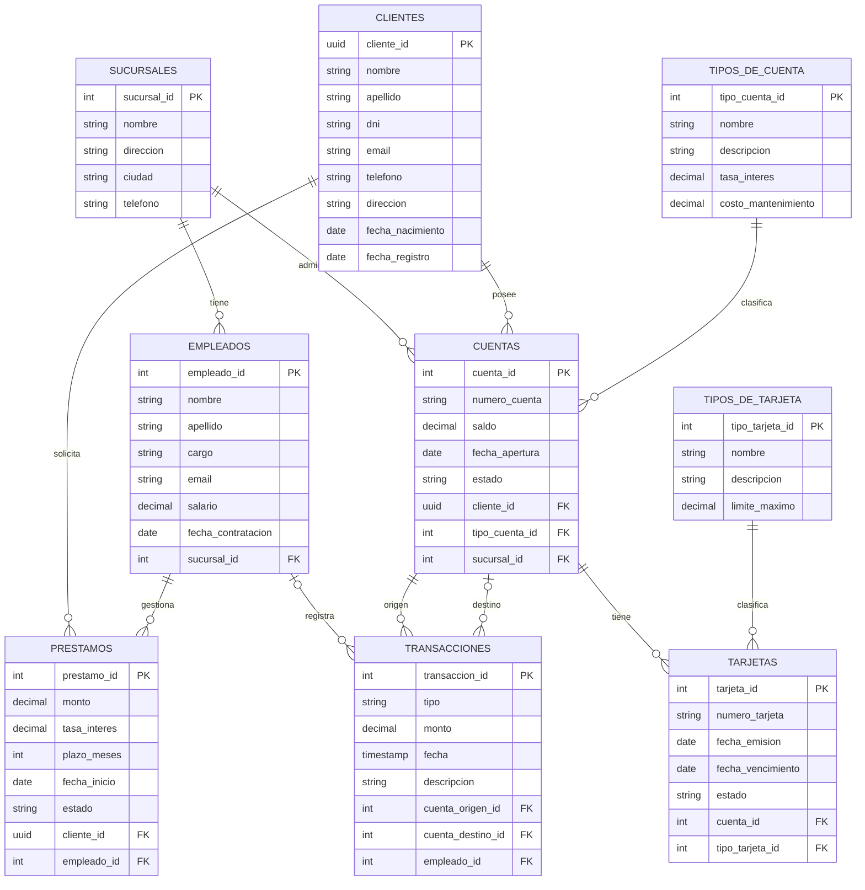

# DER (Diagrama Entidad-Relación)

GitHub renderiza este diagrama automáticamente.

## Resumen de relaciones

- Una sucursal tiene muchos empleados y administra muchas cuentas (1:N).
- Un cliente puede tener muchas cuentas y muchos préstamos (1:N).
- Un tipo de cuenta clasifica muchas cuentas (1:N).
- Una cuenta tiene muchas transacciones y muchas tarjetas (1:N).
- Un tipo de tarjeta clasifica muchas tarjetas (1:N).
- Un empleado gestiona muchos préstamos y puede registrar transacciones (1:N).
