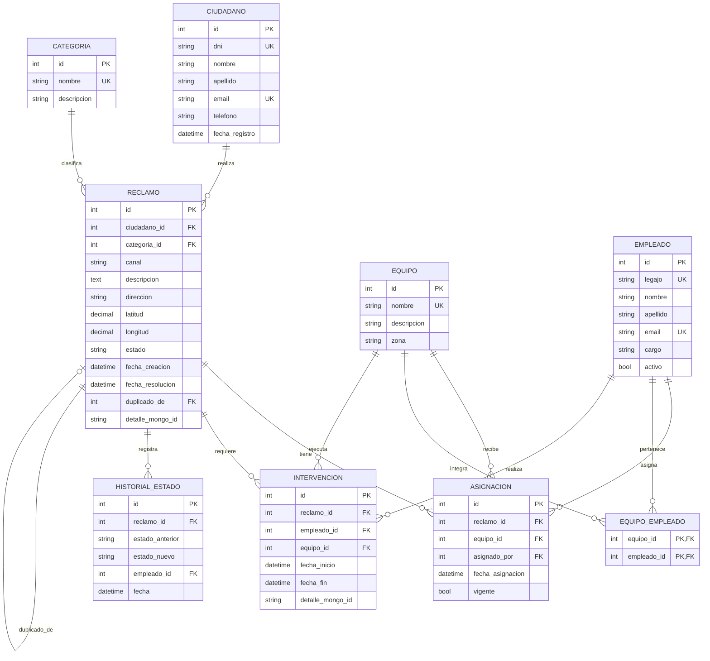

# Sistema de Reclamos Municipales (PostgreSQL + MongoDB)

Trabajo práctico de bases de datos relacionales y documentales.

## 1. Arquitectura

**PostgreSQL (relacional):** lo usamos para guardar los datos estructurados y con reglas claras: ciudadanos, empleados, equipos, categorías, reclamos (con su estado, fecha y ubicación), asignaciones, intervenciones e historial de estados. Es la base que usamos para sacar todas las estadísticas.

**MongoDB (documental):** la usamos para la información flexible o que cambia según el caso: los detalles propios de cada tipo de reclamo, las fotos, las tareas realizadas, las observaciones y cualquier dato adicional de cada intervención.

### Integración entre ambas bases

- PostgreSQL guarda la referencia al documento de Mongo: `reclamo.detalle_mongo_id` e `intervencion.detalle_mongo_id`.
- MongoDB guarda los IDs relacionales: `reclamo_id`, `intervencion_id` y `empleado_id`.
- La aplicación (API) es la que junta ambas fuentes. Para consultar el **historial completo** de un reclamo:
  1. Se consulta PostgreSQL: reclamo, historial de estados, asignaciones e intervenciones (quién participó y cuándo).
  2. Se consulta MongoDB por `reclamo_id`: detalle del reclamo y detalle de cada intervención (qué se hizo, fotos, observaciones).
  3. La API combina ambos resultados en una sola respuesta.
- **Orden de escritura:** primero se inserta el documento en MongoDB (para obtener su `_id`) y después se guarda el registro en PostgreSQL dentro de una transacción. Si PostgreSQL falla, se elimina el documento creado, así no quedan datos huérfanos.

## 2. Diagrama Entidad-Relación



### Relaciones principales

- El ciudadano realiza reclamos y la categoría los clasifica.
- Un reclamo se asigna a un equipo (formado por empleados) y puede requerir una o varias intervenciones.
- Cada cambio de estado queda registrado en el historial, y un reclamo puede marcarse como duplicado de otro (`duplicado_de`).

### Tablas (PostgreSQL)

| Tabla | Qué guarda |
|-------|-----------|
| `ciudadano` | Datos básicos de la persona (DNI, nombre, mail, teléfono). |
| `empleado` | Personal municipal (legajo, cargo, si está activo). |
| `equipo` | Grupos de trabajo (nombre, zona). |
| `equipo_empleado` | Relación N:M entre empleados y equipos. |
| `categoria` | Tipo de reclamo. |
| `reclamo` | Núcleo del sistema: quién lo hizo, canal, descripción, ubicación (lat/long), estado, fechas y `detalle_mongo_id`. |
| `asignacion` | A qué equipo se asignó cada reclamo, quién lo asignó y cuándo. |
| `intervencion` | Trabajo realizado en campo: quién participó, fechas de inicio y fin, y `detalle_mongo_id`. |
| `historial_estado` | Registro de cómo fue cambiando el estado de cada reclamo. |

### Colecciones (MongoDB)

| Colección | Qué guarda | Se enlaza con |
|-----------|-----------|---------------|
| `reclamo_detalle` | Datos específicos según categoría (número de poste, tipo de cañería, etc.) y fotos. | `reclamo.id` |
| `intervencion_detalle` | Tareas realizadas, observaciones, fotos y datos adicionales. | `intervencion.id` y `empleado.id` |

## 3. Scripts

- `sql/01_schema.sql`: crea las tablas, índices y triggers, y carga las categorías iniciales.
- `sql/02_datos_prueba.sql`: datos de ejemplo para probar el funcionamiento.
- `sql/03_estadisticas.sql`: consultas para obtener estadísticas (reclamos por categoría, por estado, intervenciones por empleado, tiempos de resolución).
- `mongo/ejemplos.js`: documentos de ejemplo, índices y consultas para MongoDB.

Ejecución por consola (la base `reclamos` debe existir antes):

```bash
createdb -U postgres reclamos
psql -U postgres -d reclamos -f sql/01_schema.sql
psql -U postgres -d reclamos -f sql/02_datos_prueba.sql
mongosh reclamos_muni mongo/ejemplos.js
```

## 4. Explicación de la solución

Dividimos la información según su naturaleza. Todo lo que es estructurado y necesita relaciones e integridad (quién hace el reclamo, qué categoría es, en qué estado está, qué empleado intervino y cuándo) lo guardamos en PostgreSQL. Ahí usamos JOINs y claves foráneas, y obtenemos las estadísticas (cantidad de reclamos por categoría, empleados con más intervenciones, tiempos de resolución) de forma simple.

Lo que cambia según el caso (los datos específicos de una luminaria, el tipo de cañería de una pérdida de agua, las fotos y las observaciones de cada intervención) lo guardamos en MongoDB. Así cada documento tiene sus propios campos y evitamos llenar PostgreSQL de columnas vacías o de una tabla distinta por cada categoría.

Las dos bases se conectan por IDs: PostgreSQL guarda la referencia al documento de Mongo y Mongo guarda los IDs relacionales. Cuando la aplicación necesita mostrar un reclamo con todo su historial, consulta ambas bases y combina los resultados.

Elegimos esta combinación porque cada base resuelve mejor un tipo de dato: MongoDB resulta incómoda para estadísticas y relaciones complejas, y PostgreSQL es más rígido para datos que varían tanto según el tipo de reclamo. Además, el enunciado pedía que ambas tuvieran una responsabilidad concreta dentro del sistema.
